# Especificação — Catálogo de templates

| Campo | Valor |
|---|---|
| Versão | 0.2 |
| Data | 2026-10-17 |
| Base | PRD RF-93, RN-29 a RN-32 · referência `docs/design/referencias/templates-referencia.webp` |
| Status | Geometria aprovada (fiel ao desenho) |

## 1. Método de transcrição

1. Molduras detectadas na imagem de referência (contorno escuro de cada quadro) e identificadas pelo rótulo de tamanho.
2. Tamanho real de cada moldura: polegadas × 2,54, arredondado a 1 mm; A4 = 21,0 × 29,7; A3 = 29,7 × 42,0.
3. Escala px → cm por modelo = mediana da razão *tamanho real / tamanho no desenho* de todas as molduras; posição = centro do desenho × escala.
4. Origem (0,0) no canto superior esquerdo do conjunto; X → direita, Y → baixo.
5. Coluna **Foto (borda 0)**: maior tamanho sugerido (RN-01) que cabe na célula sem borda, na orientação da célula (quadrada → retrato), conforme RN-29. Com borda, o tamanho é recalculado ao aplicar.

**Divergência com a referência:** os totais calculados ficam 0–15% menores que os declarados no infográfico (o desenho usa vãos de ~3–5 cm; os totais declarados implicam vãos maiores). Ver §3.

## 2. Modelos

Legenda dos esboços: moldura do modelo = contorno preto; foto sugerida sem borda = tracejado vermelho; número = vaga (ordem da tabela).

### 2.1 Pirâmide (`piramide`)

Total calculado **151,0 × 70,6 cm** · declarado na referência 164 × 82 cm · 6 vagas

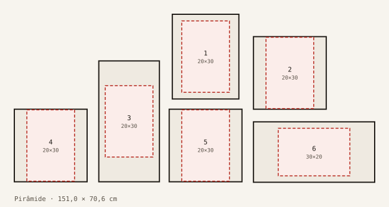

| # | Moldura | Célula L × A (cm) | X (cm) | Y (cm) | Foto (borda 0) |
|---|---|---|---|---|---|
| 1 | 11x14" retrato | 27,9 × 35,6 | 66,2 | 0,0 | 20 × 30 |
| 2 | 12x12" quadrado | 30,5 × 30,5 | 100,2 | 9,4 | 20 × 30 |
| 3 | 10x20" retrato | 25,4 × 50,8 | 35,4 | 19,6 | 20 × 30 |
| 4 | 12x12" quadrado | 30,5 × 30,5 | 0,0 | 39,9 | 20 × 30 |
| 5 | 12x12" quadrado | 30,5 × 30,5 | 64,9 | 39,9 | 20 × 30 |
| 6 | 10x20" paisagem | 50,8 × 25,4 | 100,2 | 45,2 | 30 × 20 |

### 2.2 Escada (`escada`)

Total calculado **70,7 × 63,1 cm** · declarado na referência 82 × 72 cm · 6 vagas

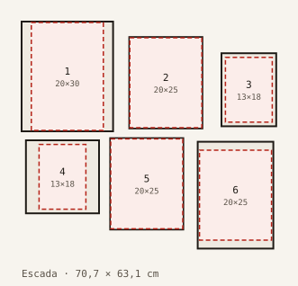

| # | Moldura | Célula L × A (cm) | X (cm) | Y (cm) | Foto (borda 0) |
|---|---|---|---|---|---|
| 1 | 10x12" retrato | 25,4 × 30,5 | 0,0 | 0,0 | 20 × 30 |
| 2 | 8x10" retrato | 20,3 × 25,4 | 29,9 | 4,3 | 20 × 25 |
| 3 | 6x8" retrato | 15,2 × 20,3 | 55,5 | 8,8 | 13 × 18 |
| 4 | 8x8" quadrado | 20,3 × 20,3 | 1,2 | 33,0 | 13 × 18 |
| 5 | 8x10" retrato | 20,3 × 25,4 | 24,6 | 32,4 | 20 × 25 |
| 6 | A4 retrato | 21,0 × 29,7 | 48,9 | 33,4 | 20 × 25 |

### 2.3 Simetria dividida (`simetria-dividida`)

Total calculado **152,0 × 106,0 cm** · declarado na referência 167 × 114 cm · 10 vagas

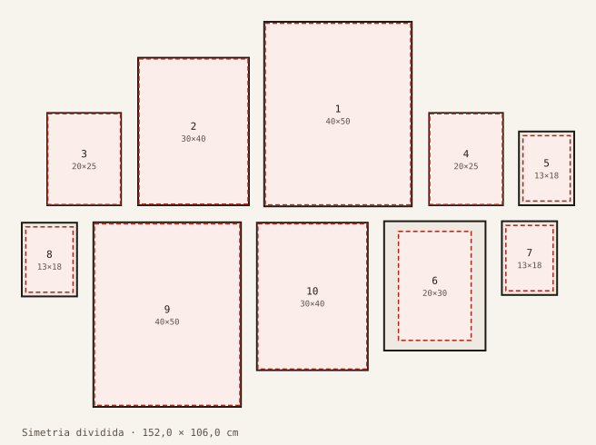

| # | Moldura | Célula L × A (cm) | X (cm) | Y (cm) | Foto (borda 0) |
|---|---|---|---|---|---|
| 1 | 16x20" retrato | 40,6 × 50,8 | 66,7 | 0,0 | 40 × 50 |
| 2 | 12x16" retrato | 30,5 × 40,6 | 32,0 | 9,9 | 30 × 40 |
| 3 | 8x10" retrato | 20,3 × 25,4 | 7,0 | 25,1 | 20 × 25 |
| 4 | 8x10" retrato | 20,3 × 25,4 | 112,1 | 25,1 | 20 × 25 |
| 5 | 6x8" retrato | 15,2 × 20,3 | 136,8 | 30,2 | 13 × 18 |
| 6 | 11x14" retrato | 27,9 × 35,6 | 99,7 | 54,9 | 20 × 30 |
| 7 | 6x8" retrato | 15,2 × 20,3 | 132,1 | 54,9 | 13 × 18 |
| 8 | 6x8" retrato | 15,2 × 20,3 | 0,0 | 55,3 | 13 × 18 |
| 9 | 16x20" retrato | 40,6 × 50,8 | 19,7 | 55,2 | 40 × 50 |
| 10 | 12x16" retrato | 30,5 × 40,6 | 64,7 | 55,3 | 30 × 40 |

### 2.4 Centralizado (`centralizado`)

Total calculado **87,0 × 77,1 cm** · declarado na referência 100 × 88 cm · 8 vagas

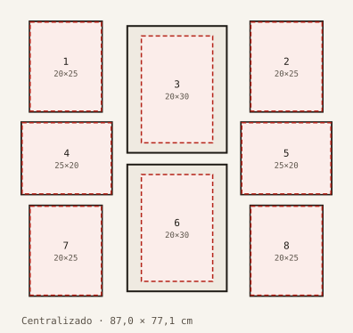

| # | Moldura | Célula L × A (cm) | X (cm) | Y (cm) | Foto (borda 0) |
|---|---|---|---|---|---|
| 1 | 8x10" retrato | 20,3 × 25,4 | 2,3 | 0,0 | 20 × 25 |
| 2 | 8x10" retrato | 20,3 × 25,4 | 64,2 | 0,0 | 20 × 25 |
| 3 | 11x14" retrato | 27,9 × 35,6 | 29,7 | 1,3 | 20 × 30 |
| 4 | 8x10" paisagem | 25,4 × 20,3 | 0,0 | 28,3 | 25 × 20 |
| 5 | 8x10" paisagem | 25,4 × 20,3 | 61,6 | 28,3 | 25 × 20 |
| 6 | 11x14" retrato | 27,9 × 35,6 | 29,7 | 40,2 | 20 × 30 |
| 7 | 8x10" retrato | 20,3 × 25,4 | 2,3 | 51,7 | 20 × 25 |
| 8 | 8x10" retrato | 20,3 × 25,4 | 64,2 | 51,7 | 20 × 25 |

### 2.5 Equilibrado (`equilibrado`)

Total calculado **131,3 × 69,0 cm** · declarado na referência 151 × 78 cm · 8 vagas

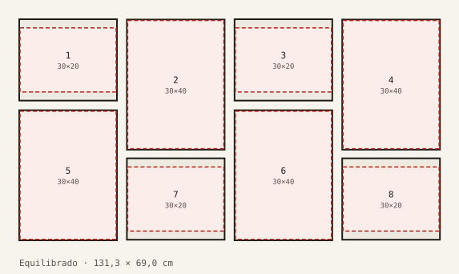

| # | Moldura | Célula L × A (cm) | X (cm) | Y (cm) | Foto (borda 0) |
|---|---|---|---|---|---|
| 1 | 10x12" paisagem | 30,5 × 25,4 | 0,0 | 0,0 | 30 × 20 |
| 2 | 12x16" retrato | 30,5 × 40,6 | 33,6 | 0,1 | 30 × 40 |
| 3 | 10x12" paisagem | 30,5 × 25,4 | 67,2 | 0,0 | 30 × 20 |
| 4 | 12x16" retrato | 30,5 × 40,6 | 100,8 | 0,1 | 30 × 40 |
| 5 | 12x16" retrato | 30,5 × 40,6 | 0,0 | 28,4 | 30 × 40 |
| 6 | 12x16" retrato | 30,5 × 40,6 | 67,2 | 28,4 | 30 × 40 |
| 7 | 10x12" paisagem | 30,5 × 25,4 | 33,6 | 43,4 | 30 × 20 |
| 8 | 10x12" paisagem | 30,5 × 25,4 | 100,8 | 43,4 | 30 × 20 |

### 2.6 Base nivelada (`base-nivelada`)

Total calculado **166,6 × 85,7 cm** · declarado na referência 183 × 92 cm · 10 vagas

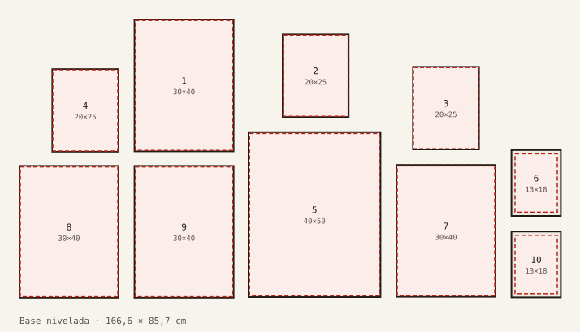

| # | Moldura | Célula L × A (cm) | X (cm) | Y (cm) | Foto (borda 0) |
|---|---|---|---|---|---|
| 1 | 12x16" retrato | 30,5 × 40,6 | 35,4 | 0,0 | 30 × 40 |
| 2 | 8x10" retrato | 20,3 × 25,4 | 81,0 | 4,6 | 20 × 25 |
| 3 | 8x10" retrato | 20,3 × 25,4 | 121,1 | 14,6 | 20 × 25 |
| 4 | 8x10" retrato | 20,3 × 25,4 | 10,1 | 15,3 | 20 × 25 |
| 5 | 16x20" retrato | 40,6 × 50,8 | 70,5 | 34,7 | 40 × 50 |
| 6 | 6x8" retrato | 15,2 × 20,3 | 151,4 | 40,2 | 13 × 18 |
| 7 | 12x16" retrato | 30,5 × 40,6 | 116,0 | 44,8 | 30 × 40 |
| 8 | 12x16" retrato | 30,5 × 40,6 | 0,0 | 45,1 | 30 × 40 |
| 9 | 12x16" retrato | 30,5 × 40,6 | 35,4 | 45,1 | 30 × 40 |
| 10 | 6x8" retrato | 15,2 × 20,3 | 151,4 | 65,3 | 13 × 18 |

### 2.7 Grade (`grade`)

Total calculado **70,4 × 69,5 cm** · declarado na referência 81 × 81 cm · 9 vagas

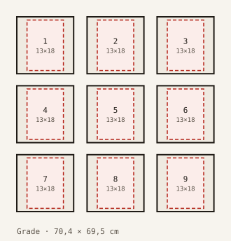

| # | Moldura | Célula L × A (cm) | X (cm) | Y (cm) | Foto (borda 0) |
|---|---|---|---|---|---|
| 1 | 8x8" quadrado | 20,3 × 20,3 | 0,0 | 0,0 | 13 × 18 |
| 2 | 8x8" quadrado | 20,3 × 20,3 | 25,1 | 0,0 | 13 × 18 |
| 3 | 8x8" quadrado | 20,3 × 20,3 | 50,1 | 0,0 | 13 × 18 |
| 4 | 8x8" quadrado | 20,3 × 20,3 | 0,0 | 24,6 | 13 × 18 |
| 5 | 8x8" quadrado | 20,3 × 20,3 | 25,1 | 24,6 | 13 × 18 |
| 6 | 8x8" quadrado | 20,3 × 20,3 | 50,1 | 24,6 | 13 × 18 |
| 7 | 8x8" quadrado | 20,3 × 20,3 | 0,0 | 49,2 | 13 × 18 |
| 8 | 8x8" quadrado | 20,3 × 20,3 | 25,1 | 49,2 | 13 × 18 |
| 9 | 8x8" quadrado | 20,3 × 20,3 | 50,1 | 49,2 | 13 × 18 |

### 2.8 Mini salão (`mini-salao`)

Total calculado **65,8 × 58,8 cm** · declarado na referência 77 × 67 cm · 5 vagas

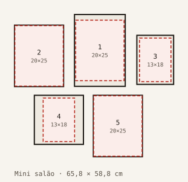

| # | Moldura | Célula L × A (cm) | X (cm) | Y (cm) | Foto (borda 0) |
|---|---|---|---|---|---|
| 1 | A4 retrato | 21,0 × 29,7 | 24,8 | 0,0 | 20 × 25 |
| 2 | 8x10" retrato | 20,3 × 25,4 | 0,0 | 4,4 | 20 × 25 |
| 3 | 6x8" retrato | 15,2 × 20,3 | 50,6 | 8,6 | 13 × 18 |
| 4 | 8x8" quadrado | 20,3 × 20,3 | 8,2 | 33,4 | 13 × 18 |
| 5 | 8x10" retrato | 20,3 × 25,4 | 32,6 | 33,4 | 20 × 25 |

### 2.9 Cata-vento (`cata-vento`)

Total calculado **76,6 × 76,6 cm** · declarado na referência 76 × 76 cm · 4 vagas

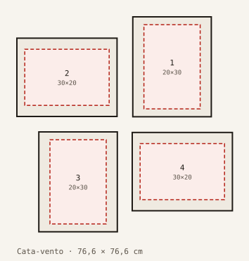

| # | Moldura | Célula L × A (cm) | X (cm) | Y (cm) | Foto (borda 0) |
|---|---|---|---|---|---|
| 1 | 11x14" retrato | 27,9 × 35,6 | 41,2 | 0,0 | 20 × 30 |
| 2 | 11x14" paisagem | 35,6 × 27,9 | 0,0 | 7,6 | 30 × 20 |
| 3 | 11x14" retrato | 27,9 × 35,6 | 7,8 | 41,0 | 20 × 30 |
| 4 | 11x14" paisagem | 35,6 × 27,9 | 41,0 | 41,2 | 30 × 20 |

### 2.10 Mondrian (`mondrian`)

Total calculado **73,4 × 50,8 cm** · declarado na referência 86 × 55 cm · 4 vagas

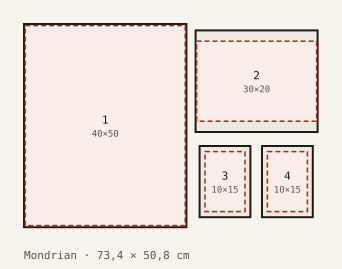

| # | Moldura | Célula L × A (cm) | X (cm) | Y (cm) | Foto (borda 0) |
|---|---|---|---|---|---|
| 1 | 16x20" retrato | 40,6 × 50,8 | 0,0 | 0,0 | 40 × 50 |
| 2 | 10x12" paisagem | 30,5 × 25,4 | 42,9 | 1,6 | 30 × 20 |
| 3 | 5x7" retrato | 12,7 × 17,8 | 43,9 | 30,5 | 10 × 15 |
| 4 | 5x7" retrato | 12,7 × 17,8 | 59,5 | 30,5 | 10 × 15 |

### 2.11 Espiral (`espiral`)

Total calculado **77,7 × 79,5 cm** · declarado na referência 92 × 92 cm · 9 vagas

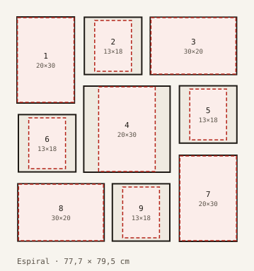

| # | Moldura | Célula L × A (cm) | X (cm) | Y (cm) | Foto (borda 0) |
|---|---|---|---|---|---|
| 1 | 8x12" retrato | 20,3 × 30,5 | 0,0 | 0,0 | 20 × 30 |
| 2 | 8x8" quadrado | 20,3 × 20,3 | 23,8 | 0,1 | 13 × 18 |
| 3 | 8x12" paisagem | 30,5 × 20,3 | 47,1 | 0,1 | 30 × 20 |
| 4 | 12x12" quadrado | 30,5 × 30,5 | 23,6 | 24,5 | 20 × 30 |
| 5 | 8x8" quadrado | 20,3 × 20,3 | 57,4 | 24,4 | 13 × 18 |
| 6 | 8x8" quadrado | 20,3 × 20,3 | 0,5 | 34,6 | 13 × 18 |
| 7 | 8x12" retrato | 20,3 × 30,5 | 57,4 | 49,0 | 20 × 30 |
| 8 | 8x12" paisagem | 30,5 × 20,3 | 0,3 | 59,1 | 30 × 20 |
| 9 | 8x8" quadrado | 20,3 × 20,3 | 33,7 | 59,1 | 13 × 18 |

### 2.12 Trio (`trio`)

Total calculado **77,2 × 42,0 cm** · declarado na referência 94 × 45 cm · 3 vagas

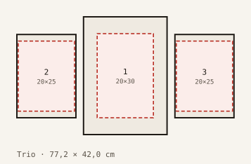

| # | Moldura | Célula L × A (cm) | X (cm) | Y (cm) | Foto (borda 0) |
|---|---|---|---|---|---|
| 1 | A3 retrato | 29,7 × 42,0 | 23,7 | 0,0 | 20 × 30 |
| 2 | A4 retrato | 21,0 × 29,7 | 0,0 | 6,3 | 20 × 25 |
| 3 | A4 retrato | 21,0 × 29,7 | 56,2 | 6,3 | 20 × 25 |

## 3. Decisões

Nenhuma. **TPL-08 (17/10): geometria fiel ao desenho** — vãos irregulares (~2–5 cm) e totais calculados prevalecem sobre os declarados na referência.
